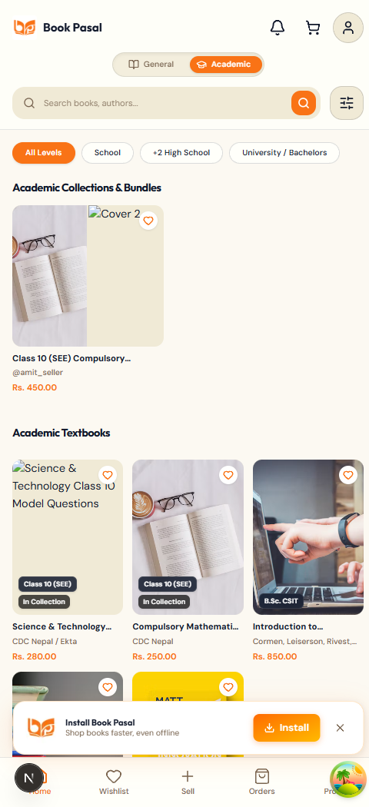
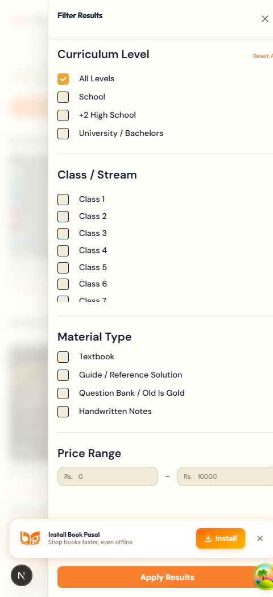
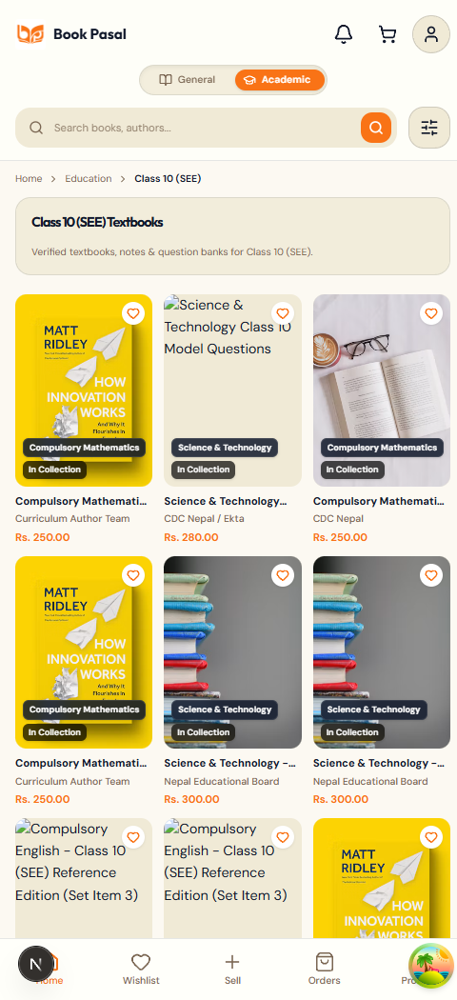
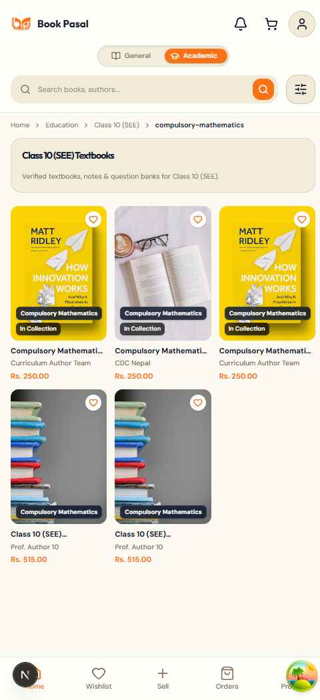
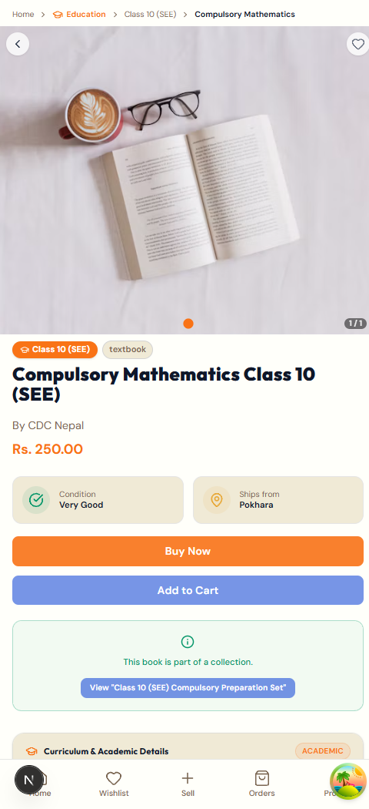
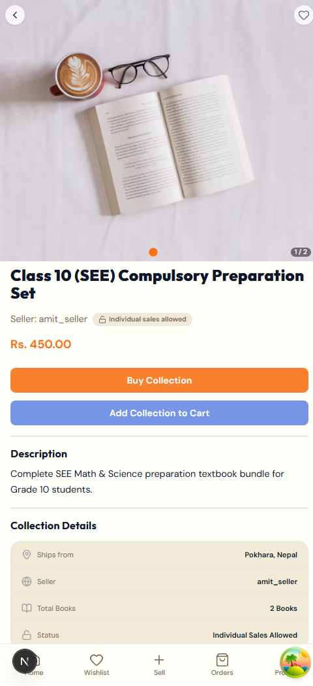
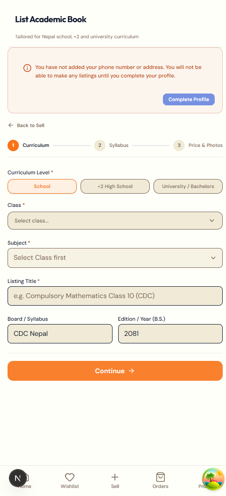
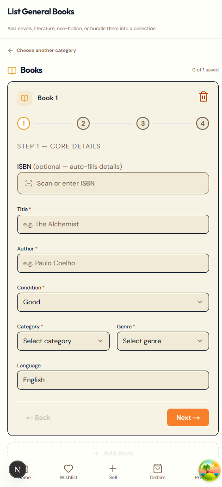

# BP-33: Education Section - Handoff Summary

- **Ticket**: [Issue #33: Education section](https://github.com/Rashik977/bookpasal-tracker/issues/33)
- **Status**: Ready for Final Review & Manual Testing (PRs Open & Updated)
- **Backend PR**: [prashantmgk/bookpasal_backend#19](https://github.com/prashantmgk/bookpasal_backend/pull/19) (`dev` ← `bp-33-education-section`)
- **Frontend PR**: [prashantmgk/bookpasal_frontend#18](https://github.com/prashantmgk/bookpasal_frontend/pull/18) (`develop` ← `bp-33-education-section`)

---

## 1. What Was Built & Overhauled
A cohesive, integrated Academic section natively built into BookPasal:

1. **BookPasal Brand & Layout Continuity**:
   - Uses the standard BookPasal `HomeTopBar` (brand logo, search input, notifications bell, cart, and profile menu).
   - Brand orange (`#f97316`) throughout: active toggle state, single pill filter strip, and action buttons. Zero arbitrary green tones.
   - Ambient warm scholastic canvas (`bg-[#fcf9f2]`) with fluid micro-transitions on toggle.
   - PWA Install Banner and Push Notification Banner preserved on `/education`.
   - Level pills placed inside sticky `HomeTopBar` directly under the search bar with exact same height, padding (`px-4 py-2`), and right-edge gradient fade (`from-background to-transparent w-16`) eliminating layout shifts or jumps.

2. **Education Browse Hub (`/education`)**:
   - Single clean pill strip: `[ All Levels ]  [ School ]  [ +2 High School ]  [ University / Bachelors ]` with no emojis.
   - Dedicated **Academic Collections & Bundles** carousel alongside Academic Textbooks in the feed.
   - Standard pagination with total pages.
   - Search-adjacent `FilterModal` overhauled for Academic: mirrors Categories with Curriculum Level pills, dynamically populated Class and Subject selectors from taxonomy, Material Type, and Price Range (removed Syllabus Version and Markings).
   - Collections isolation: Backend prevents academic collections from leaking into general home or general search via `.whereNotExists` on academic books.
   - Instantaneous wishlist toggle via TanStack Query cache invalidation on `["education"]`.
   - `BookCard`: defaulted `originalPrice = ""` eliminating unwanted discount badges (`-20%`, `-29%`) and struck-through prices; academic badge neutralized.

3. **Streamlined Sell Flow (`/sell`, `/sell/general`, & `/sell/academic`)**:
   - Dedicated `/sell` 2-card selector: `[ 📖 Literature & General ]` vs `[ 🎓 Academic & Textbooks ]` with zero camera auto-pop on mount.
   - General sell flow cleanly moved to `/sell/general`.
   - Dedicated `/sell/academic` form with:
     - MUI-style single-select autocomplete for Class and Subject: text box with dropdown suggestions, instant click/enter selection, and inline custom typing support without extra secondary inputs.
     - Multi-book listing via `AcademicBookAccordion` (`+ Add Another Academic Book`).
     - Academic Collection bundling support: sellers can check "Group books into an academic collection", bundle 2+ academic books with a discount (10-50%), and publish atomically via `POST /api/listing`.
     - Comprehensive Nepal syllabi seeds: all Grades 1–10 (CDC), +2 NEB streams, and top 19 Bachelor/Master degrees with official subjects.
     - Strict `react-hook-form` validation with inline error messages placed directly under each field.
     - Nepali B.S. edition year input (`2081`).

4. **SEO & Academic Details**:
   - Dynamic SEO curriculum routes (`/education/[classSlug]/[[...subjectSlug]]`).
   - Clean academic detail card on `/book/[id]` with curriculum-aware related textbook recommendations.

---

## 2. Per-Slice Breakdown & Commits

| Slice / Step | Highlights | BE Commits | FE Commits |
|---|---|---|---|
| **Slice 01** | Taxonomy migration, seed, `GET /api/education/taxonomy`, search partitioning, `ModeSwitcher` | `37cc812` | `78dcdaf` |
| **Slice 02** | Academic book persistence schema, `/sell/academic` 3-step listing wizard | `dd90cf0` | `77c431b` |
| **Slice 03** | `GET /api/education/books` filtering API, `/education` browse hub with Level/Class/Subject chips | `87709bd` | `370cff0` |
| **Slice 04** | Slug resolution API, `/education/[classSlug]/[subjectSlug]` SEO pages | `74e72c9` | `4a899ad` |
| **Slice 05** | Academic taxonomy joins on `/book/[id]`, `AcademicDetailsCard`, curriculum recommendations | `b8cf85b` | `4c92421` |
| **Review Fixes** | Related query in `educationModal`, graceful slug fallback, custom subject input, `old_course` warning pill, `useAuthGuard` | `ac1d5f9` | `24cafca` |
| **Overhaul & Polish (Round 1 & 2)** | Academic collections feed, expanded CDC/NEB/TU seeds, BS edition year, MUI autocomplete, Level pills in top bar, FilterModal taxonomy filters, /sell hub, collection bundling, load seeds | `a1195f3`, `3b0f143`, `da936c7`, `414a529` | `46075b8`, `459e2a1`, `36725da`, `1873730`, `3fae532` |

---

## 3. Automated Verification Summary

- **Backend**:
  - Tests: `npm test` -> **PASS (7 test files, 26 tests passed - 100% pass rate)**
  - Lint: `npm run lint` -> **PASS (0 errors, 0 warnings)**
  - Format: `npm run format:check` -> **PASS (Prettier verified)**
  - Load Seed: `npm run seed:load:academic` -> **PASS (60 academic books, 6 collections seeded)**
- **Frontend**:
  - Tests: `npm test` -> **PASS (8 test files, 16 tests passed - 100% pass rate)**
  - Build: `npm run build` -> **PASS (Production build succeeded, all dynamic & static routes valid)**
  - Format: `npm run format:check` -> **PASS (Prettier verified)**
  - Lint: `npm run lint` -> **PASS (0 errors; baseline pre-existing warnings preserved)**
- **Mobile Viewport Evidence (480px × 1050px)**:
  | Screen / Feature | Viewport | Screenshot |
  | :--- | :--- | :--- |
  | **Education Hub** (Brand Header, Level Pills Under Search with Fade, Bundles, Textbooks, PWA Banner) | Mobile (480x1050) |  |
  | **Academic Filter Modal** (Curriculum Level, Dynamic Class & Subject, Material Type, Price Range) | Mobile (480x1050) |  |
  | **Curriculum Class View & Breadcrumbs** (`Home > Education > Class 10 (SEE)`, Hero Card, Real Book Grid) | Mobile (480x1050) |  |
  | **Curriculum Subject View & Breadcrumbs** (`Home > Education > Class 10 (SEE) > Compulsory Mathematics`) | Mobile (480x1050) |  |
  | **Academic Book Detail** (Breadcrumbs, Cover Carousel, Condition, Academic Details Card) | Mobile (480x1050) |  |
  | **Academic Collection / Bundle Detail** (Course Bundle Details, Bundle Price, Included Books) | Mobile (480x1050) |  |
  | **Sell Landing Hub** (Choice Cards: Literature vs Academic, No Camera Auto-Popup) | Mobile (480x1050) |  |
  | **Academic Sell Wizard** (MUI Autocomplete Class & Subject, BS Year, Multi-Book & Collection Bundling) | Mobile (480x1050) |  |
  | **General Sell Flow** (Multi-Book Accordion, Optional General Collection Bundling) | Mobile (480x1050) |  |

---

## 4. Manual Test Checklist for Rashik

1. **Brand Continuity & Header**:
   - Open `http://localhost:3000` at mobile viewport width (480px).
   - Tap `[ 🎓 Academic ]` in the mode switcher -> transitions smoothly to `bg-[#fcf9f2]` and loads `/education`.
   - Verify standard `HomeTopBar` with BookPasal logo, notifications bell, cart, and profile menu.
   - Verify PWA install banner appears at the bottom.
2. **Pill Strip & Bundles**:
   - On `/education`, verify single pill row: `[ All Levels ]  [ School ]  [ +2 High School ]  [ University / Bachelors ]` with brand orange active state and no emojis.
   - Verify `Academic Collections & Bundles` carousel appears with the SEE Complete Set bundle card.
   - Verify textbook cards display clean NPR prices (`Rs. 280.00`) without discount percentage badges or struck-through prices.
   - Tap a wishlist heart on any textbook -> verify it turns orange immediately.
3. **Filter Modal**:
   - Tap the filter icon next to the search input.
   - Verify the filter modal opens with academic filters: Material Type, Syllabus Version, and Markings Status.
4. **Sell Flow**:
   - Navigate to `http://localhost:3000/sell`.
   - Verify NO camera scanner automatically pops up.
   - Verify two choice cards: `Literature & General Books` vs `Academic & Textbooks`.
   - Tap `Academic & Textbooks` -> navigates to `/sell/academic`.
   - Test Curriculum Level pills (`School`, `+2 High School`, `University / Bachelors`).
   - Test `Class` autocomplete: type to search (e.g. `BSc CSIT` or `Class 10`) or type a custom class name.
   - Verify `Subject` dropdown updates with relevant CDC/NEB/TU subjects.
   - Try tapping `Continue` without subject -> verify inline error message appears directly under the field.
   - Verify Edition Year field is formatted in B.S. (e.g. `2081`).
   - Verify no "Price Negotiable" checkbox.
5. **Academic Details Page**:
   - From `/education`, tap any textbook (e.g. `Compulsory Mathematics Class 10`).
   - Verify academic details card, clean badges (no green), and curriculum-related books at the bottom.

---

## 5. Risks & Notes for Prashant / Reviewer
- All changes are strictly additive or isolated to the academic mode.
- Existing general books and general feeds remain 100% untouched and partitioned away from academic listings.
- Direct push to protected branches is blocked; PRs are ready for squash/merge by Rashik or Prashant.
