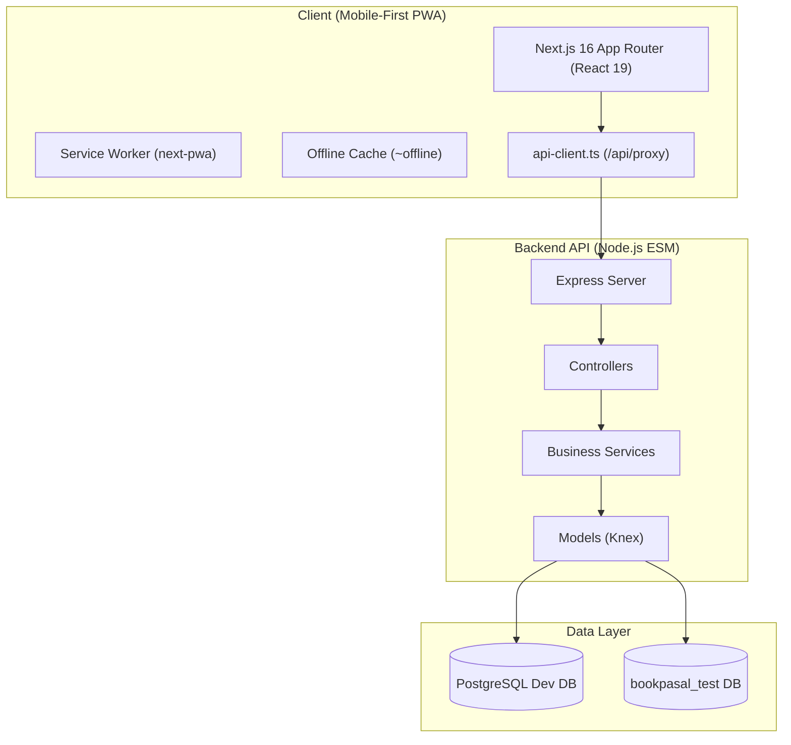
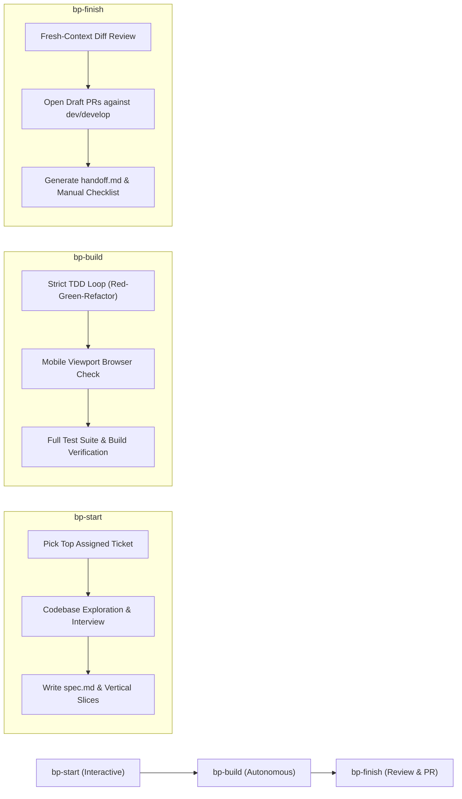

# Architecture Report: BookPasal

## 1. Executive Summary & Philosophy
BookPasal is a digital marketplace for buying and selling used and new books (academic, textbooks, and general literature) across Nepal. The platform is designed around low-bandwidth resilience, offline capabilities, and a strict **mobile-first Progressive Web App (PWA)** paradigm. 

> [!IMPORTANT]
> **Mobile-First PWA Mandate**: BookPasal is engineered and optimized primarily for mobile browsers and PWA installation. The desktop experience is currently unpolished and secondary. ALL UI testing, browser verifications, and visual assertions MUST be performed in mobile viewport dimensions (e.g., 375x667, 390x844).

The workspace comprises three sibling repositories:
1. `bookpasal_frontend`: Next.js 16 (TypeScript) App Router with Tailwind CSS and PWA service workers.
2. `bookpasal_backend`: Node.js (ESM) / Express API with Knex query builder and PostgreSQL.
3. `bookpasal-tracker`: Personal tracking repository containing specifications, vertical slices, ADRs, and domain glossary.

---

## 2. System Architecture & Component Layout

### 2.1 Frontend Architecture (`bookpasal_frontend`)
- **Framework**: Next.js 16.1.6 (App Router), React 19.2.3, TypeScript 5.
- **Styling & UI**: Tailwind CSS 4, `class-variance-authority` (CVA), `tailwind-merge` for atomic UI primitives in `components/ui/`.
- **PWA Support**: `@ducanh2912/next-pwa`, custom service worker in `worker/index.ts`, offline route fallback at `app/~offline`.
- **Data Fetching & Async State**: TanStack React Query v5. Queries in `server/queries/`, mutations in `server/mutations/`.
- **Form State**: `react-hook-form` with strict TypeScript validation interfaces.
- **API Routing**: Client-side network requests route via `/api/proxy/[...path]` using `parseResponse` from `lib/api-client.ts`. Server-side data fetching utilizes `apiServerFetch` from `lib/api-server.ts`.

### 2.2 Backend Architecture (`bookpasal_backend`)
- **Framework**: Node.js v24 (ESM: `"type": "module"`), Express 4.18.2.
- **Architecture**: Strict Controller-Service-Model separation:
  - `src/controllers/`: Route handlers managing HTTP request validation and standardized response delivery.
  - `src/services/`: Pure business logic and domain rules.
  - `src/models/`: Knex data-access layer.
- **Database & Migrations**: PostgreSQL, Knex.js 3.1.0 with migration scripts in `migrations/` and seed scripts in `seeds/dev`.
- **Response Standardization**: `responseHandler.js` providing `success`, `paginated`, and `error` payloads. Never raw `res.send()` or `res.json()`.
- **Error Handling**: Centralized `errorHandler.js` catching `AppError`, JWT errors, and PostgreSQL constraint violations.

---

## 3. Workflow & Engineering Discipline

Development on BookPasal follows a rigid vertical-slice and TDD lifecycle managed across three skills:

### 3.1 Non-Negotiable Engineering Principles
1. **Vertical Slices Only**: Every slice spans from database migrations through backend routes, services, frontend components, and tests for a single demonstrable behavior. Horizontal work ("all models first", "all UI last") is strictly prohibited.
2. **Strict Test-Driven Development (TDD)**: One failing test via the public interface first -> minimal implementation code -> refactor while green.
3. **Zero-Mock Database Testing**: Backend integration tests run against a real local PostgreSQL database (`bookpasal_test`), never mocks or in-memory stubs.
4. **Mobile Browser Verification**: UI changes must be verified against mobile screen dimensions with screenshots recorded in `evidence/`.
5. **Git Safety & Collaborator Rules**:
   - `bookpasal_backend` base branch is `dev`.
   - `bookpasal_frontend` base branch is `develop`.
   - Work happens exclusively on feature branches `bp-<issue#>-<slug>`.
   - Agent creates DRAFT PRs only (`gh pr create --draft`). No direct pushes to base branches, no force pushes, no automated merging.
